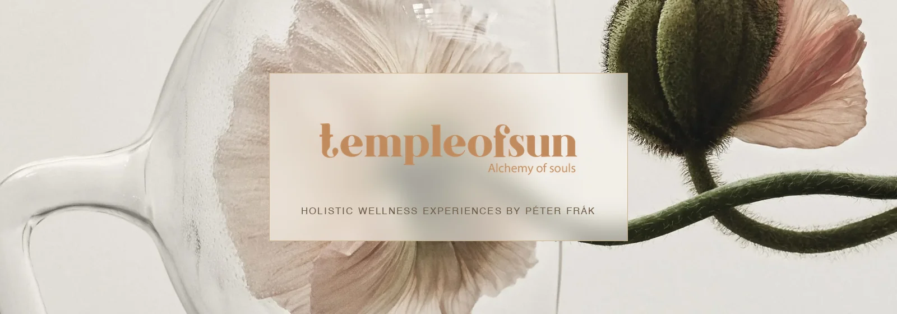
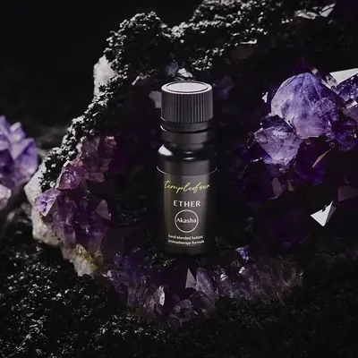

<p align="center">
  <a href="https://templeofsun.github.io/"></a>
</p>

<h1 align="center">templeofsun.github.io</h1>

<p align="center">
  <b>The website of Péter Frák: aromatherapy blends, treatments, meditation and Soul Alchemy Retreats.</b><br>
  This repo holds the whole site as plain files, and GitHub shows it at the test address below.
</p>

<p align="center">
  <a href="https://templeofsun.github.io/"></a>
  <a href="robots.txt"></a>
  <a href="#what-it-looks-like"></a>
  <a href="#what-it-looks-like"></a>
  <a href="SECURITY-HEADERS.md"></a>
  <a href="#where-things-live"></a>
</p>
<p align="center">
  <a href="https://github.com/templeofsun/templeofsun.github.io/commits/main"></a>
  <a href="translations/README.md"></a>
  <a href="#road-to-launch"></a>
</p>

<p align="center">
  <a href="#publish-a-change">Publish a change</a> ·
  <a href="#where-things-live">Where things live</a> ·
  <a href="#which-file-changes-which-page">Which file changes which page</a> ·
  <a href="#what-it-looks-like">What it looks like</a> ·
  <a href="#road-to-launch">Road to launch</a> ·
  <a href="#all-the-guides">All the guides</a>
</p>

<details>
<summary><b>Table of contents</b></summary>

- [The site at a glance](#the-site-at-a-glance)
- [Publish a change](#publish-a-change)
- [Where things live](#where-things-live)
- [Which file changes which page](#which-file-changes-which-page)
- [What it looks like](#what-it-looks-like)
- [Rules for editing](#rules-for-editing)
- [What was checked](#what-was-checked)
- [Road to launch](#road-to-launch)
- [All the guides](#all-the-guides)
- [Credits and rights](#credits-and-rights)

</details>

<table align="center">
  <tr>
    <td align="center"><br><sub>Home</sub></td>
    <td align="center"><br><sub>The blends</sub></td>
    <td align="center"><br><sub>Retreats</sub></td>
    <td align="center"><br><sub>Philosophy</sub></td>
  </tr>
</table>

---

## The site at a glance

| | |
|---|---|
| **Pages** | 25 main pages, 23 blend pages, and a journal |
| **Test address** | https://templeofsun.github.io/ |
| **Real domain** | templeofsun.com, moving to Cloudflare before launch |
| **Search engines** | Kept out until launch by `robots.txt` |
| **Languages** | English. Portuguese, Hungarian and German are prepared in `translations/`, not started |
| **Look** | Light by default, dark when a visitor taps the sun/moon button. Phone layout with a folding menu |

> [!NOTE]
> This is a private preview. The address works for anyone who has it, but search engines are asked to stay away until launch.

---

## Publish a change

Run the build on your computer first. It rewrites the menu, the footer, the generated pages and the security headers.

```bash
python3 tools/prepare-for-upload.py
```

When it works you see `Folder is ready to upload.` at the end.

Then copy the folder into this repo, commit and push to `main`. GitHub rebuilds the test site in about a minute.

> [!IMPORTANT]
> Never skip the build. Without it the security headers no longer match the pages, and some page scripts stop working.

> [!WARNING]
> On launch day only, run the build with `--live`. It switches `robots.txt` from "stay away" to "welcome" so Google can find the site. The full launch checklist is in [`START-HERE-CLOUDFLARE.md`](START-HERE-CLOUDFLARE.md).

---

## Where things live

```text
.
├── index.html, retreats.html, …   the 25 main pages
├── checkout.html, thanks.html     the shop's checkout and thank-you pages (hidden from search)
├── products/                      the 23 blend pages (built, see the next section)
├── journal/                       Péter's journal posts
├── css/site.css                   all styling: colours at the top, dark mode and phone fixes at the bottom
├── js/site.js                     menu, footer, slideshow, gallery, lightbox, forms, light/dark button
├── css/shop.css                   cart panel, checkout and thank-you page styling
├── js/shop.js                     the cart, checkout and order sending (settings at the top)
├── js/shop-data.js                the cart's price list (built, do not edit)
├── js/shop-postage.js             postage rates and countries for the checkout (edit by hand)
├── js/img-fallback.js             loads first on every page: picks light or dark, catches broken images
├── assets/                        photos, guest videos, fonts, icons
├── docs/images/                   the pictures in this README
├── tools/                         build scripts and the data they read
├── translations/                  ready for Portuguese, Hungarian, German
├── _headers, _redirects           security headers and old-address redirects, used by Cloudflare
└── robots.txt, sitemap.xml, llms.txt
```

---

## Which file changes which page

Some pages are built from data files. Edit the file on the left, run the build, and the pages on the right update.

| Edit this | To change |
|---|---|
| `tools/blend-pages.json` | the 23 blend pages and the cart's prices (`js/shop-data.js`) |
| `js/shop-postage.js` | postage rates and countries at checkout |
| `tools/session-pages.json` | Health Consultation, Spiritual Mentoring, Meditation Guidance |
| `js/site.js` (`HEADER`, `MOBILE`, `FOOTER`) | the menu and footer on every page |
| `tools/redirects.json` | old addresses that forward to new pages |
| `tools/press-credits.json` | the press credits |

> [!TIP]
> If you edit one of these pages by hand, the next build overwrites your change. Edit the data file instead.

---

## What it looks like

<p>
  
  
  
  
  
  
  
</p>

| | |
|---|---|
| **Type** | Cormorant Garamond for headings, Inter for text. Both are stored in the site, not loaded from Google |
| **Motion** | One soft easing everywhere. Sections fade up as you scroll |
| **Dark mode** | A deep warm brown with cream text. Photos stay as they are |
| **On a phone** | A folding menu with a close button, two blends per row, nothing that scrolls sideways |

---

## Rules for editing

- **Facts come from Péter.** Prices, dates, names and oil safety are never invented.
- **His voice stays his.** Warm, devotional, first person. Don't polish it.
- **Photos** are WebP, compressed, with file names that say what is in them.
- **Outside services** such as YouTube, booking widgets or analytics are blocked until their address is added to `tools/generate-headers.py`.

---

## What was checked

On 10 November 2026:

- Every page at three phone widths (360, 375 and 430 pixels): no page scrolls sideways.
- Light and dark mode on every type of page: an automatic check for text that is hard to read, with three spots fixed.
- Every link between pages, images and files: none point to a missing file.

---

## Road to launch

Not dates, just the order.

- [x] All pages, blends, retreat gallery and journal
- [x] Light and dark mode
- [x] Phone layout
- [x] Translation folders prepared
- [ ] Contact form and newsletter connected
- [ ] Domain moved to Cloudflare
- [ ] Launch build with `--live`
- [x] Cart and checkout (orders go to Péter, no online payment)
- [ ] Shop sending: on Cloudflare, add an order function and set `orderUrl` at the top of `js/shop.js`
- [ ] Shop: postage prices and tax details from Péter
- [ ] Translations: Portuguese, then Hungarian, then German

---

## All the guides

| Guide | Read it when |
|---|---|
| [`START-HERE-CLOUDFLARE.md`](START-HERE-CLOUDFLARE.md) | You are about to launch, or moving the site to Cloudflare |
| [`SECURITY-HEADERS.md`](SECURITY-HEADERS.md) | You add anything from another website, or a page script stops working |
| [`translations/README.md`](translations/README.md) | You start a translation |

---

## Credits and rights

This repo is public so the test site can run. That does not make the content free to reuse: the words, photos, blends and the templeofsun name are not open for copying. Please ask first.

<p align="center">
  <sub>templeofsun · alchemy of souls · Portugal &amp; Hungary</sub>
</p>
